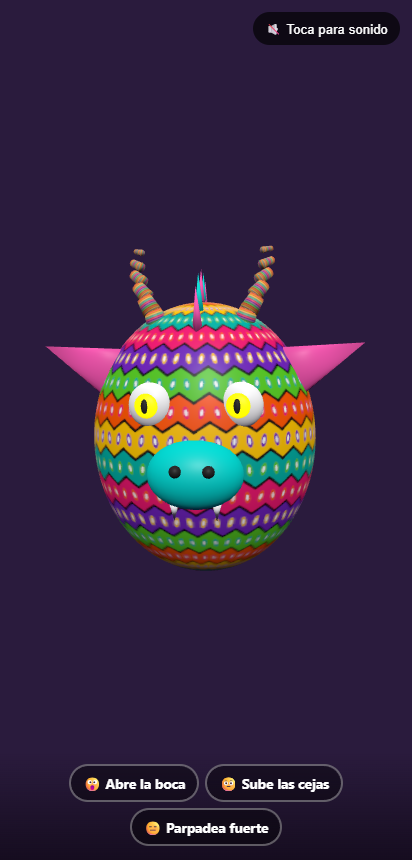
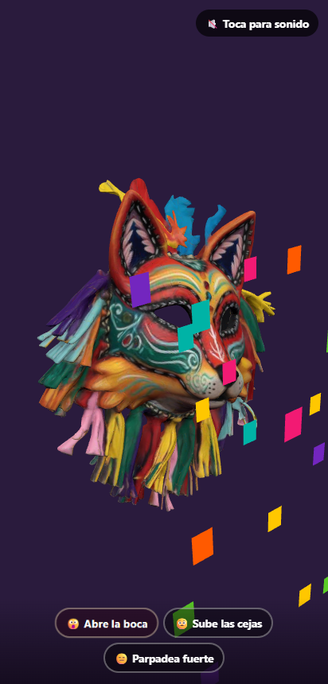

# Filtro Alebrije

Filtro facial de **realidad aumentada** para el navegador del teléfono. Al abrir la página se enciende la cámara frontal, se detecta tu rostro y se cubre con una **máscara de zorro de fiesta con pintura de alebrije**, generada en Meshy a partir de mi diseño y ajustada, con esqueleto y animación, en **Blender**. La máscara sigue los giros de tu cabeza y reacciona a tus gestos.

> Actividad 2 · Realidad Virtual y Aumentada · 2026

**Pruébalo:** https://filtro-alebrije.carlos-gomez-dev13.workers.dev/ · **Modo demo en PC:** https://filtro-alebrije.carlos-gomez-dev13.workers.dev/?demo

| Máscara animada | Reacción a "abre la boca" |
|---|---|
|  |  |

## Gestos

| Gesto | Señal de MediaPipe | Reacción |
|---|---|---|
| 😮 Abrir la boca | `jawOpen > 0.5` | **Rugido:** explosión de confeti desde el hocico del zorro, la máscara late y suena un rugido |
| 🤨 Subir las cejas | `browInnerUp > 0.55` | La máscara **cambia de colores** (5 tintes) con campanitas |
| 😑 Parpadear fuerte | `eyeBlinkLeft` y `eyeBlinkRight > 0.6` | La máscara **destella en dorado** y salen chispas de los ojos |

Cada gesto usa un disparador con umbral, un rearme por debajo de 0.3 y una pausa mínima de 0.8 a 1.2 s (`js/gestos.js`), para que un gesto sostenido no dispare varias veces. Los chips de la parte inferior se iluminan con cada disparo.

## La máscara (Meshy + Blender)

Me inspiré en las máscaras de danza de Oaxaca (zorros, tigres y diablos de madera tallada con flecos de listón) y en la pintura de los alebrijes de San Martín Tilcajete.

1. **Modelo base:** lo generé con **Meshy AI** a partir de mi prompt: un zorro de fiesta con pintura de alebrije, plumas y flecos de colores (200 k caras, texturas PBR de 2048 px, 13.6 MB).
2. **Adaptación y animación en Blender** con `blender/mascara_zorro.py`. El archivo editable es `blender/mascara_zorro.blend`.
   - **Optimización:** la malla baja a 40 k caras y las texturas a 1024 px. El GLB queda en 2.3 MB.
   - **Ajuste a la cara:** la máscara se escala y se coloca en el espacio del modelo canónico de MediaPipe, en centímetros. Los huecos de los ojos quedan sobre los ojos del usuario (±3.16 cm, landmarks 33/133/159/145) y el reverso queda 1 cm frente al rostro.
   - **Esqueleto propio:** 8 huesos para plumas, orejas, flecos laterales y barba de listones. Los pesos se calculan con transiciones suaves, así que cada fleco se dobla en lugar de moverse como bloque.
   - **Animación de 2 s en bucle (24 fps):** los flecos se mecen como péndulos desfasados, las plumas ondean y las orejas dan un tirón a mitad del ciclo.

Para regenerarla, con el GLB de Meshy descargado:

```bash
blender --background --python blender/mascara_zorro.py -- <zorro_meshy.glb>
```

## Cómo funciona

1. `getUserMedia` abre la cámara frontal en cuanto carga la página, sin pantallas intermedias.
2. **MediaPipe Face Landmarker** (`@mediapipe/tasks-vision`) devuelve en cada cuadro la matriz de transformación facial y 52 blendshapes.
3. La máscara cuelga de un grupo de three.js cuya matriz es la matriz facial, con un suavizado ligero (lerp/slerp 0.65) contra el temblor. Se ve con una cámara de 63° de FOV vertical, la misma que usa MediaPipe.
4. El video y el canvas comparten `object-fit: cover` y el efecto espejo, así que el recorte y la alineación coinciden en cualquier pantalla.

## Herramientas

- Meshy AI: modelo base de la máscara.
- Blender 5.2 (Python `bpy`): optimización, ajuste a la cara, esqueleto y animación.
- MediaPipe Tasks Vision 0.10.14: Face Landmarker con blendshapes.
- three.js 0.160: render, GLTFLoader y AnimationMixer.
- Web Audio API: efectos sintetizados.

## Instalación y uso

```bash
git clone https://github.com/CharlieMorales13/filtro-alebrije.git && cd filtro-alebrije
npx serve .
```

- La cámara requiere **HTTPS** o `localhost`. Para el teléfono, publica la carpeta en **Vercel** o **Cloudflare Pages** (sitio estático, sin build).
- La primera vez que tocas la pantalla se activa el sonido (los navegadores lo exigen).
- Modo demo sin cámara: `index.html?demo`. Teclas 1, 2 y 3 para probar las reacciones.
- Modo foto: `index.html?imagen=ruta/a/foto.jpg` aplica el filtro a una imagen fija.
- Prueba del disparador de gestos: `node js/gestos.test.mjs`.

## Estructura

```
index.html                    video, canvas y chips de gestos
css/styles.css
js/main.js                    cámara, detección, seguimiento, reacciones
js/gestos.js                  disparador con umbral, rearme y pausa
js/audio.js                   efectos con Web Audio
assets/mascara_zorro.glb      máscara exportada desde Blender
blender/                      script y .blend fuente
```

## Créditos y licencias

| Recurso | Autor / fuente | Licencia |
|---|---|---|
| Código, ajuste, esqueleto y animación de la máscara | Carlos Antonio Gómez Morales | MIT (ver `LICENSE`) |
| Modelo base de la máscara (prompt propio) | Generado con [Meshy AI](https://www.meshy.ai), plan gratuito | CC BY 4.0 |
| Efectos de sonido | Sintetizados en código, autoría propia | MIT |
| MediaPipe Tasks Vision y modelo Face Landmarker | Google | Apache 2.0 |
| three.js | three.js authors | MIT |
| Blender | Blender Foundation | GPL (la herramienta; el contenido creado es propio) |
